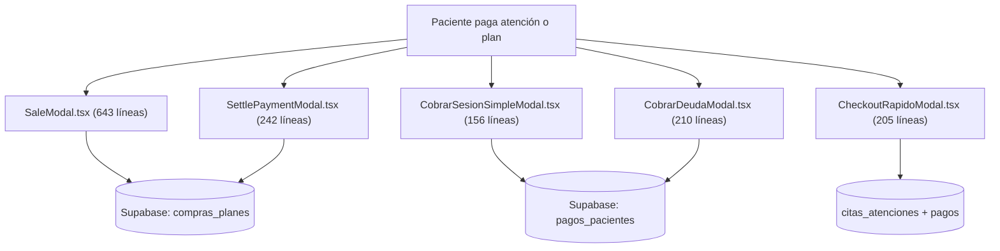
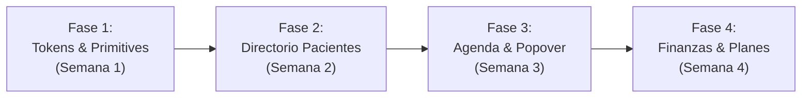

# REPORTE DE AUDITORÍA INTEGRAL DE FRONTEND, UI/UX Y DESIGN SYSTEM
**Proyecto:** `kiromov-core` | Centro Clínico de Kinesiología & TMO  
**Rol Auditor:** Principal Frontend Architect & Lead Product Designer (SaaS / HealthTech)  
**Fecha:** Octubre 2026  
**Modo:** Solo Lectura (Inspección Exhaustiva de Código, Rutas y Componentes)  
**Estándar de Calidad Referencial:** Linear, Apple Health, Cal.com, Stripe Dashboard  

---

## ÍNDICE DE CONTENIDOS
1. [Resumen Ejecutivo & Matriz de Hallazgos](#1-resumen-ejecutivo--matriz-de-hallazgos)
2. [Diagnóstico Detallado por Pantalla](#2-diagnóstico-detallado-por-pantalla)
   - 2.1 [Directorio Clínico y Pacientes (`/pacientes`)](#21-directorio-clínico-y-pacientes-srcapppacientespagetsx-y-srcapppagetsx)
   - 2.2 [Agenda de Box (`/agenda`)](#22-agenda-de-box-srcappagendapagetsx-y-componentes-asociados)
   - 2.3 [Finanzas & Caja (`/finanzas`)](#23-finanzas--caja-srcappfinanzaspagetsx)
   - 2.4 [Catálogo Maestro de Tarifas (`/planes`)](#24-catálogo-maestro-de-tarifas-srcappplanespagetsx)
   - 2.5 [Shell Global, Layout y Expediente Clínico (`ClinicalRecordView`)](#25-shell-global-layout-y-expediente-clínico-clinicalrecordview)
3. [Catálogo de Deuda Técnica Visual](#3-catálogo-de-deuda-técnica-visual)
   - 3.1 [Dispersión Cromática y Caos de Tokens (315 clases únicas de color)](#31-dispersión-cromática-y-caos-de-tokens)
   - 3.2 [Inconsistencia de Radios, Sombras y Jerarquía Tipográfica](#32-inconsistencia-de-radios-sombras-y-jerarquía-tipográfica)
   - 3.3 [Ausencia de Fuentes Web y Números Tabulares](#33-ausencia-de-fuentes-web-y-números-tabulares-tabular-nums)
   - 3.4 [Inventario de Código Muerto y Componentes Huérfanos (>2.600 líneas)](#34-inventario-de-código-muerto-y-componentes-huérfanos)
   - 3.5 [Proliferación y Fragmentación de Modales de Cobro (5 modales distintos)](#35-proliferación-y-fragmentación-de-modales-de-cobro)
4. [Propuesta de Design System Unificado: "Kiromov Precision"](#4-propuesta-de-design-system-unificado-kiromov-precision)
   - 4.1 [Filosofía de Diseño Clínico](#41-filosofía-de-diseño-clínico)
   - 4.2 [Tokens Semánticos de Color (Emerald & Slate)](#42-tokens-semánticos-de-color-emerald--slate)
   - 4.3 [Tipografía, Escala y Regla Tabular Obligatoria](#43-tipografía-escala-y-regla-tabular-obligatoria)
   - 4.4 [Arquitectura Modal de 3 Zonas (Estándar AAS)](#44-arquitectura-modal-de-3-zonas-estándar-aas)
   - 4.5 [Densidad Ergonómica de Datos (Compact Data Grid vs Loose Cards)](#45-densidad-ergonómica-de-datos-compact-data-grid-vs-loose-cards)
5. [Roadmap de Refactorización en 4 Fases Priorizadas](#5-roadmap-de-refactorización-en-4-fases-priorizadas)

---

## 1. RESUMEN EJECUTIVO & MATRIZ DE HALLAZGOS

`kiromov-core` cuenta con una lógica de negocio rica, pensada específicamente para el flujo kinesiológico (TMO, dolor ENA, control de sesiones, derivaciones y caja diaria). Sin embargo, a nivel de **Arquitectura Frontend, Experiencia de Usuario (UI/UX) y Cohesión de Diseño**, la aplicación sufre de problemas estructurales que impactan directamente en la velocidad operativa del profesional en el box, la claridad financiera y la escalabilidad del código.

### Principales Conclusiones del Diagnóstico:
1. **Arquitectura 100% Client-Side en Next.js 15 (Anti-patrón SPA):** El 100% de las rutas principales (`/`, `/agenda`, `/pacientes`, `/finanzas`, `/planes`) están marcadas con `'use client'`. No se aprovechan los React Server Components (RSC), el streaming de datos, ni las suspense boundaries nativas. Toda la base de datos se descarga completa en memoria en el navegador cliente mediante hooks monolíticos con hasta 35 `useState`.
2. **Dispersión Visual Crítica (Falta de Design System):** El escaneo del código fuente identificó **315 combinaciones de clases de color distintas** en Tailwind, una mezcla caótica entre una paleta personalizada (`ink-navy`, `signal-blue`, `pebble`, `hairline`) y colores estándar de Tailwind (`slate-*`, `blue-*`, `emerald-*`, `indigo-*`, `amber-*`, `rose-*`, `teal-*`, `purple-*`). No existe un tema institucional unificado basado en **Kiromov Emerald / Slate**.
3. **Desperdicio Espacial y Baja Densidad de Información:** En pantallas de laptop habituales de consulta (MacBook 13"-15" / 1440x900 - 1512x982), la acumulación de filtros en múltiples pisos horizontales (hasta 430px de altura vertical antes del primer registro) y el uso de tarjetas sobredimensionadas impiden una visualización ágil: en `/pacientes` solo se observan entre 3 y 6 pacientes simultáneos de un universo de 126.
4. **Proliferación y Fragmentación de Modales:** Existen **5 modales distintos para cobrar/registrar pagos** (`SaleModal`, `CobrarSesionSimpleModal`, `CobrarDeudaModal`, `SettlePaymentModal`, `CheckoutRapidoModal`) con lógica divergente de inserción y actualización en base de datos.
5. **Código Muerto y Duplicación de Rutas:** Se identificaron **más de 2.600 líneas de componentes huérfanos** con 0 importaciones activas (`AgendaHeader`, `AgendaSidebar`, `MedicalTimeGrid`, `ScheduleSettingsModal`, `SOAPModal`, `SoapTimelineAccordion`, y 5 primitivas de UI en `src/components/ui/`), sumado a una **duplicación crítica de ruta** en `src/app/page.tsx` que aloja una copia obsoleta de la vista de pacientes.

### Matriz de Hallazgos Priorizados

| # | Dimensión | Severidad | Hallazgo Principal | Ubicación Clave | Impacto en Negocio / UX |
|---|---|---|---|---|---|
| **H-01** | Routing / Arquitectura | **CRÍTICA** | `src/app/page.tsx` contiene un clon desactualizado de `/pacientes` llamado `PacientesPage`. Carga datos desalineados en `/`. | `src/app/page.tsx:1-352` | Confusión total del usuario al navegar a la raíz; desincronización de fichas y filtros. |
| **H-02** | UI / Ergonomía | **CRÍTICA** | Triple piso de filtros horizontales en Directorio de Pacientes devora >430px verticales. Solo caben 3-6 tarjetas visibles. | `src/app/pacientes/page.tsx:466-624` | Fatiga del kinesiólogo: obliga a scrollear >10.000px para revisar 126 pacientes. |
| **H-03** | Arquitectura / Código | **CRÍTICA** | Proliferación de 5 modales de cobro desarticulados con lógica duplicada y riesgo de inconsistencia contable. | `src/components/sales/*`, `src/components/agenda/CheckoutRapidoModal.tsx` | Fallos de caja, estados de pago desfasados, deuda técnica severa (1.456 líneas redundantes). |
| **H-04** | UI / Ergonomía | **ALTA** | Clic en cita en Agenda abre un `<Dialog>` bloqueante con backdrop completo en vez de un Popover contextual anclado. | `src/app/agenda/page.tsx:1001-1050` | Pérdida de contexto espacial; flujo lento para consultar datos del paciente o enviar WhatsApp. |
| **H-05** | UI / Responsive | **ALTA** | Grid semanal de Agenda fuerza `min-w-[1200px]`, causando overflow y scroll horizontal en laptops estándar con sidebar. | `src/components/agenda/ClinicalTimeGrid.tsx:161` | Columna de sábado cortada o escondida en pantallas de 13" y 14" (1280px y 1440px). |
| **H-06** | UX / Consistencia | **ALTA** | Tabla "Quién Debe" en Finanzas no agrupa por paciente: repite al mismo paciente en múltiples filas. | `src/app/finanzas/page.tsx:472-585` | Dificultad para saber la deuda real consolidada por persona; corte de texto en botones `[ 💬 Wh... ]`. |
| **H-07** | Design System | **ALTA** | Coexistencia de 315 clases de color; falta de identidad cromática Kiromov Emerald / Slate; semáforo ultrasaturado en citas. | Todo el repositorio (`tailwind.config.ts`, `globals.css`) | Fatiga visual clínica, apariencia de prototipo desarticulado y falta de rigor visual corporativo. |
| **H-08** | Arquitectura / Perf | **ALTA** | 100% Client Components (`'use client'`). Carga no paginada de tablas completas (`citas`, `pacientes`, `compras_planes`, `egresos`). | Todas las rutas de `src/app/` | Bundles de JS inflados, render blocks y lentitud progresiva a medida que la clínica acumula registros. |
| **H-09** | Código Muerto | **MEDIA** | 14 componentes huérfanos con 0 imports (>2.600 líneas de código inútil en el bundle/árbol). | `src/components/agenda/*`, `src/components/clinical/*`, `src/components/ui/*` | Confusión de mantenimiento y lentitud en análisis estático de TypeScript. |
| **H-10** | Micro-tipografía | **MEDIA** | Ausencia casi absoluta de `tabular-nums` (solo 2 usos) y fuentes web `Gilroy`/`Manrope` nunca cargadas en runtime. | `src/app/globals.css`, `src/app/layout.tsx` | Desalineación de cifras monetarias ($) y horas; fallback silencioso a fuentes genéricas del sistema. |

---

## 2. DIAGNÓSTICO DETALLADO POR PANTALLA

### 2.1 Directorio Clínico y Pacientes (`src/app/pacientes/page.tsx` y `src/app/page.tsx`)

#### Hallazgo 2.1.1: Triple piso horizontal de filtros devora el viewport
* **Ubicación:** [src/app/pacientes/page.tsx:466-624](file:///Users/ignaciocuevas/Desktop/kiromov-core/src/app/pacientes/page.tsx#L466-L624)
* **Diagnóstico Conceptual:** La pantalla apila verticalmente 3 bloques masivos antes del listado:
  1. *Piso 1 (Líneas 467-500):* 3 tarjetas KPI superiores de altura fija con tipografía desproporcionada `text-[38px]`.
  2. *Piso 2 (Líneas 502-566):* Barra con 6 chips anatómicos TMO (`Todos`, `Lumbar`, `Cervical`, `Hombro`, `EEII`, `ATM`) más un selector de modo de vista (`Tarjetas` vs `Tablero`).
  3. *Piso 3 (Líneas 568-624):* Pestañas de estado clínico (`Todos`, `🟢 Vigentes`, `🟡 Por Renovar`, `🔴 En Riesgo`, `⚪ Finalizados`) junto al input de búsqueda.
* **Impacto en Pantalla:** En un monitor de 1440x900 con la barra superior de navegación (56px) y padding general, los filtros consumen **más de 430px de altura vertical**. El usuario solo dispone de ~400px útiles para ver pacientes.
* **Solución Arquitectónica:** Consolidar en una **Bandeja de Control Unificada de un solo piso** (estilo *Linear Filters*):
  - Integrar la búsqueda global y un selector compacto de segmento TMO (Dropdown/Segmented Control).
  - Convertir las pestañas de estado en un Pill Group compacto en línea.
  - Reducir las 3 KPI cards superiores a una barra de estadísticas minimalista en la cabecera (texto en una sola línea: `Planes Vigentes: 24 · Por Renovar: 6 · Total: 126`).

#### Hallazgo 2.1.2: Ausencia de Data Grid real y baja densidad en modo "Tarjetas"
* **Ubicación:** [src/app/pacientes/page.tsx:887-1035](file:///Users/ignaciocuevas/Desktop/kiromov-core/src/app/pacientes/page.tsx#L887-L1035)
* **Diagnóstico Conceptual:** Aunque el selector dice `Tarjetas` vs `Tablero` (con icono `<Table />` para tarjetas, lo cual es semánticamente inconsistente), la vista por defecto renderiza una cuadrícula de tarjetas de 3 columnas (`grid grid-cols-1 md:grid-cols-2 xl:grid-cols-3 gap-4`). Cada tarjeta mide entre 220px y 260px de alto, conteniendo bloques de tratamiento, barras de progreso, alertas y hasta 4 botones de acción.
* **Impacto en Pantalla:** En una pantalla de 1440x900 solo caben **entre 3 y 6 tarjetas** sin hacer scroll. Para auditar la cartera de 126 pacientes, el profesional debe desplazarse por más de 42 filas (>10.000 píxeles de scroll vertical). No existe una vista tabular compacta para escanear rápidamente saldos o contactos.
* **Solución Arquitectónica:** Implementar una **Tabla Clínica Compacta de Alta Densidad (Clinical Data Grid)**:
  - Filas de 40px de altura con columnas fijas: `Paciente (Nombre + RUT)`, `Previsión`, `Segmento TMO`, `Plan Activo`, `Saldo Sesiones (ej: 4/10)`, `Estado de Pago`, `Acciones Rápidas (WhatsApp, Agendar, Ficha)`.
  - En 1440x900 permite ver **18 a 22 pacientes simultáneos de un solo vistazo**.
  - Mantener el modo Kanban como vista secundaria opcional para gestión de ciclo de vida del paciente.

#### Hallazgo 2.1.3: Proliferación de 8 modales montados simultáneamente en el árbol DOM
* **Ubicación:** [src/app/pacientes/page.tsx:1039-1163](file:///Users/ignaciocuevas/Desktop/kiromov-core/src/app/pacientes/page.tsx#L1039-L1163)
* **Diagnóstico Conceptual:** La página monta en su retorno JSX 8 componentes modales pesados:
  `SaleModal`, `PatientModal`, `AppointmentModal`, `AssignTreatmentModal`, `RenewPlanDialog`, `DischargeReportModal`, `EditPatientDialog`, `ManagePlanModal`, más la suite completa `ClinicalRecordView` (que a su vez monta otros 11 modales internamente).
* **Impacto en Performance:** Cada modal mantiene listeners, estados locales de formulario y referencias a Supabase, aumentando drásticamente el consumo de memoria del navegador y provocando lentitud en transiciones de pestaña.
* **Solución Arquitectónica:** Utilizar un patrón de **Modal Manager / Dynamic Slot** con carga perezosa (`React.lazy` / `dynamic()` de Next.js), montando únicamente el modal activo según un estado discriminado (`activeModal: { type: 'renew' | 'edit' | 'assign', data: any } | null`).

#### Hallazgo 2.1.4: Duplicación crítica de ruta en `src/app/page.tsx`
* **Ubicación:** [src/app/page.tsx:1-352](file:///Users/ignaciocuevas/Desktop/kiromov-core/src/app/page.tsx#L1-L352)
* **Diagnóstico Conceptual:** El archivo raíz `src/app/page.tsx` contiene un componente llamado `export default function PacientesPage()`, que es una copia antigua y desactualizada de la vista de pacientes (carece del tablero Kanban, de la depuración de duplicados, de los segmentos TMO actualizados). 
* **Impacto:** Si el usuario accede a `https://kiromov.cl/` en lugar de `/agenda` o `/pacientes`, ve una interfaz obsoleta y desalineada con la base de datos real.
* **Solución Arquitectónica:** Reemplazar `src/app/page.tsx` por una redirección limpia a `/agenda` (`redirect('/agenda')` en un Server Component puro) o por un **Dashboard Operativo Matutino** (KPIs del día, citas de hoy, caja rápida).

---

### 2.2 Agenda de Box (`src/app/agenda/page.tsx` y componentes asociados)

#### Hallazgo 2.2.1: Ausencia de Popover flotante contextual al hacer clic en una cita
* **Ubicación:** [src/app/agenda/page.tsx:36](file:///Users/ignaciocuevas/Desktop/kiromov-core/src/app/agenda/page.tsx#L36), [src/app/agenda/page.tsx:1001-1050](file:///Users/ignaciocuevas/Desktop/kiromov-core/src/app/agenda/page.tsx#L1001-L1050)
* **Diagnóstico Conceptual:** 
  1. En la línea 36 se importa `import { AppointmentPopover } from '@/components/agenda/AppointmentPopover'`, pero **nunca se utiliza en el renderizado**.
  2. En su lugar, el evento `onSelectCita` activa `isPopoverOpen`, el cual renderiza un `<Dialog>` tradicional centrado en la pantalla con backdrop oscuro semitransparente (`DialogHeader`, `DialogBody`, etc.).
  3. Adicionalmente, el propio archivo `AppointmentPopover.tsx` internamente tampoco era un Popover flotante: implementaba un `fixed inset-0 z-50 flex items-center justify-center p-4 bg-slate-900/60 backdrop-blur-sm` (un modal de pantalla completa).
* **Impacto en UX:** Al hacer clic en una cita para una tarea rápida (ver teléfono, cambiar estado a asistió o enviar WhatsApp de confirmación), se bloquea toda la grilla de la agenda, obligando a abrir y cerrar un modal pesado. En herramientas de alto rendimiento como Google Calendar, Cal.com o Linear, el detalle aparece en un Popover flotante anclado geométricamente al bloque horario sin perder la vista semanal de fondo.
* **Solución Arquitectónica:** Implementar un **Popover contextual real con Radix UI (`@radix-ui/react-popover`)**:
  - Anclado dinámicamente al bloque de cita (`trigger` posicionado en el evento clic).
  - Acciones rápidas en un clic: Semáforo de estado, botón directo de WhatsApp, saldo de sesiones y enlace para abrir el expediente completo.
  - Cierre automático al hacer clic en cualquier otra celda horaria.

#### Hallazgo 2.2.2: Distorsión visual de bloques horarios vs duración real de la cita
* **Ubicación:** [src/components/agenda/ClinicalTimeGrid.tsx:21](file:///Users/ignaciocuevas/Desktop/kiromov-core/src/components/agenda/ClinicalTimeGrid.tsx#L21), [ClinicalTimeGrid.tsx:336-342](file:///Users/ignaciocuevas/Desktop/kiromov-core/src/components/agenda/ClinicalTimeGrid.tsx#L336-L342)
* **Diagnóstico Conceptual:** 
  - La grilla define una altura fija de 60px por hora (`HOUR_HEIGHT = 60`).
  - Para citas de 45 minutos (la duración estándar de sesión en Kiromov), la altura calculada es: `(45 / 60) * 60 - 2 = 43px`.
  - Para citas de 30 minutos, la fórmula produce 28px, pero la línea 340 impone un `Math.max(38, ...)` para que quepan los textos.
* **Impacto Visual:**
  - El clamping forzado a 38px distorsiona la escala del tiempo: una cita de 30 minutos ocupa casi el mismo espacio que una de 45 minutos (38px vs 43px), descalibrando visualmente la agenda.
  - En 43px de alto, la tarjeta intenta embutir 3 líneas de texto (rango horario en 10px, nombre en 12px bold, motivo en 10px) más padding vertical, provocando que los textos se superpongan o se corten violentamente por `overflow-hidden`.
* **Solución Arquitectónica:**
  - Aumentar la escala base a **80px o 90px por hora** (estándar Google Calendar / Cal.com), permitiendo que 45 minutos equivalgan a 60px y 30 minutos a 40px con respiro tipográfico holgado.
  - Aplicar tipografía adaptativa por altura de slot: si la cita es <30 min, mostrar en una sola línea compacta: `09:00 Juan Pérez (4/10 ses.)`.

#### Hallazgo 2.2.3: Desborde horizontal y recorte de la columna de Sábado
* **Ubicación:** [src/components/agenda/ClinicalTimeGrid.tsx:161](file:///Users/ignaciocuevas/Desktop/kiromov-core/src/components/agenda/ClinicalTimeGrid.tsx#L161)
* **Diagnóstico Conceptual:** El contenedor de la grilla tiene forzado `min-w-[1200px]`. En pantallas portátiles de 13" o 14" (resolución 1280x800 o 1440x900), tras descontar el Sidebar izquierdo fijo (240px) y el padding del layout (`p-4 md:p-6` = 48px), el ancho disponible es de **1152px** a **1184px**.
* **Impacto Visual:** La grilla siempre activa una barra de desplazamiento horizontal indeseada. La columna de **Sábado** (el día de mayor demanda clínica matutina) queda sistemáticamente oculta fuera del campo de visión primario, requiriendo desplazamiento horizontal continuo.
* **Solución Arquitectónica:**
  - Eliminar el `min-w-[1200px]` rígido y pasar a un grid flexible con `min-w-0 flex-1 grid grid-cols-6` (Lunes a Sábado).
  - Utilizar un Sidebar colapsable (modo icono de 64px) en pantallas <1440px para garantizar 1300px+ de espacio útil para la grilla semanal.

#### Hallazgo 2.2.4: Colores ultrasaturados (100% Fill) en lugar de tokens clínicos tipo Linear
* **Ubicación:** [src/components/agenda/ClinicalTimeGrid.tsx:77-123](file:///Users/ignaciocuevas/Desktop/kiromov-core/src/components/agenda/ClinicalTimeGrid.tsx#L77-L123)
* **Diagnóstico Conceptual:** La función `getPastelCardTheme` (a pesar de su nombre "Pastel") aplica fondos sólidos al 100% de saturación con texto blanco:
  - Confirmada: `bg-emerald-600 text-white border-l-4 border-l-emerald-800`
  - Atendida: `bg-slate-700 text-slate-100 border-l-4 border-l-slate-900`
  - Inasistencia: `bg-rose-600 text-white border-l-4 border-l-rose-800`
  - Pendiente: `bg-amber-500 text-white border-l-4 border-l-amber-700`
* **Impacto Visual:** Cuando la agenda tiene 8 o 10 citas por día, la pantalla se transforma en un "muro de ladrillos de colores chillones" que satura la vista y dificulta la lectura ágil de los nombres de los pacientes.
* **Solución Arquitectónica:** Adoptar el estándar visual de **Linear / Cal.com**:
  - Fondos suaves al 8%-12% de opacidad (`bg-emerald-50/80`, `bg-amber-50/80`, `bg-slate-50`).
  - Barra lateral de acento de 3px (`border-l-3 border-emerald-500`).
  - Tipografía de alto contraste en gris oscuro (`text-slate-900` font-medium) para máxima legibilidad bajo la iluminación del box kinésico.

#### Hallazgo 2.2.5: Mutación de base de datos dentro del hook de lectura (`loadAgenda`)
* **Ubicación:** [src/app/agenda/page.tsx:207-215](file:///Users/ignaciocuevas/Desktop/kiromov-core/src/app/agenda/page.tsx#L207-L215)
* **Diagnóstico Conceptual:** Dentro de la función `loadAgenda` (que se ejecuta al montar la página y en cada cambio de fecha), existe una rutina que detecta si hay citas futuras marcadas como "asistió" y lanza mutaciones asíncronas no controladas a Supabase (`supabase.from('citas_atenciones').update(...).then()`).
* **Impacto:** Efectos secundarios ocultos durante operaciones de lectura idempotentes, generando condiciones de carrera y re-renders impredecibles.
* **Solución:** Mover esta sanitización a una función de base de datos (PostgreSQL trigger o Cron job) o a una Server Action de backend explícita.

---

### 2.3 Finanzas & Caja (`src/app/finanzas/page.tsx`)

#### Hallazgo 2.3.1: Falta de consolidación por paciente en la tabla "Quién Debe"
* **Ubicación:** [src/app/finanzas/page.tsx:463-585](file:///Users/ignaciocuevas/Desktop/kiromov-core/src/app/finanzas/page.tsx#L463-L585)
* **Diagnóstico Conceptual:** La pestaña "Quién Debe" concatena dos listas de forma secuencial sin agrupar:
  1. `planesPendientesLista.map(...)` (planes con saldo pendiente)
  2. `citasPendientesLista.map(...)` (citas asistidas individuales sin plan y no pagadas)
* **Impacto Operativo:** Si un paciente (ej. "Carlos Muñoz") tiene un plan con cuota pendiente y además asistió a dos sesiones kinésicas adicionales impagas, **aparece en 3 filas independientes** dispersas en la tabla. El kinesiólogo o secretaria no puede saber de inmediato el total consolidado que adeuda el paciente, y corre el riesgo de cobrarle una sola cita en vez de regularizar su saldo global.
* **Solución Arquitectónica:**
  - Realizar una agregación por `paciente_id` (`Map<pacienteId, { paciente, deudaTotal, desglose: [] }>`).
  - Renderizar una fila maestra por paciente que muestre el saldo deudor consolidado total con un acordeón desplegable que detalle el origen de la deuda (Plan X + Citas del dd/mm).
  - Botón unificado de cobranza: `[ 💬 Cobrar Deuda Total $70.000 ]`.

#### Hallazgo 2.3.2: Botones de acción truncados y desborde en tabla de 7 columnas
* **Ubicación:** [src/app/finanzas/page.tsx:510-533](file:///Users/ignaciocuevas/Desktop/kiromov-core/src/app/finanzas/page.tsx#L510-L533)
* **Diagnóstico Conceptual:** La tabla posee 7 columnas (`Paciente`, `Teléfono`, `Adeuda`, `Total`, `Pagado`, `Debe`, `Acción`). En la columna `Acción`, se ubican horizontalmente dos botones con padding amplio:
  `<Button variant="outline">💬 WhatsApp</Button>` y `<Button>💵 Registrar Pago</Button>`.
* **Impacto Visual:** Con clases `whitespace-nowrap`, en viewports de 1280px a 1440px la columna de acción excede el ancho de celda y se comprime, recortando el texto a `[ 💬 Wh... ]` o empujando la tabla hacia un scroll horizontal destructivo.
* **Solución Arquitectónica:**
  - En la celda de acción, utilizar un botón primario compacto (`💵 Cobrar`) y un botón secundario iconográfico (`💬` con tooltip "Cobrar vía WhatsApp").
  - Ocultar columnas secundarias como `Teléfono` en pantallas medianas, dejando el acceso directo al teléfono como un subtexto debajo del nombre del paciente.

#### Hallazgo 2.3.3: Tarjetas KPI con nula profundidad analítica
* **Ubicación:** [src/app/finanzas/page.tsx:329-359](file:///Users/ignaciocuevas/Desktop/kiromov-core/src/app/finanzas/page.tsx#L329-L359)
* **Diagnóstico Conceptual:** Las 4 tarjetas (`Ingresos Reales`, `Egresos`, `Flujo Neto`, `Por Cobrar`) solo muestran números estáticos brutos.
* **Impacto en Decisión Clínica/Negocio:**
  - No muestran variación respecto al período anterior (ej. `+14.2% vs mes anterior`).
  - No presentan tasa de efectividad de cobranza (`% Cobrado vs Emitido`).
  - No desglosan los medios de pago (Transbank vs Transferencia vs Efectivo), información crítica para el cuadre de caja diario de la clínica.
* **Solución Arquitectónica:** Enriquecer las KPI cards con indicadores de tendencia Delta (`+X% vs mes ant.`), barra de progreso de cobranza mensual y minigráfico Sparkline de ingresos diarios.

---

### 2.4 Catálogo Maestro de Tarifas (`src/app/planes/page.tsx`)

#### Hallazgo 2.4.1: Texto redundante `+ + Nuevo Plan / Tarifa`
* **Ubicación:** [src/app/planes/page.tsx:244-251](file:///Users/ignaciocuevas/Desktop/kiromov-core/src/app/planes/page.tsx#L244-L251)
* **Diagnóstico Conceptual:**
  ```tsx
  <button onClick={handleOpenCreate} className="...">
    <Plus className="h-4 w-4" />
    <span>+ Nuevo Plan / Tarifa</span>
  </button>
  ```
* **Impacto:** Se renderizan dos signos más contiguos (`+ + Nuevo Plan / Tarifa`), denotando descuido en el pulido tipográfico y visual.
* **Solución:** Remover el carácter `+` del texto interno del `<span>` y preservar únicamente el icono Lucide `<Plus />`.

#### Hallazgo 2.4.2: Falta de métricas de negocio y pacientes activos por plan
* **Ubicación:** [src/app/planes/page.tsx:336-444](file:///Users/ignaciocuevas/Desktop/kiromov-core/src/app/planes/page.tsx#L336-L444)
* **Diagnóstico Conceptual:** Las tarjetas del catálogo solo presentan: Nombre, Categoría, Badge de Tipo, N° de Sesiones, Precio Total y Valor Calculado por Sesión.
* **Impacto:** El kinesiólogo o director médico no tiene visibilidad de qué planes son rentables o populares:
  - No indica cuántos pacientes activos están cursando actualmente cada plan.
  - No indica el volumen de ventas acumulado en el mes por plan.
* **Solución Arquitectónica:** Incorporar un badge informativo de tracción en cada tarjeta: `👥 18 pacientes activos` y `📈 42% de las ventas del mes`.

#### Hallazgo 2.4.3: Incoherencia en Arquitectura de Información (Sidebar vs Contenido)
* **Ubicación:** [src/components/layout/Sidebar.tsx:36-40](file:///Users/ignaciocuevas/Desktop/kiromov-core/src/components/layout/Sidebar.tsx#L36-L40)
* **Diagnóstico Conceptual:** En la barra lateral se anuncia la ruta como:
  `{ name: 'Configuración', href: '/planes', emoji: '⚙️' }`
  Sin embargo, la pantalla a la que llega el usuario es exclusivamente el `Catálogo Maestro de Tarifas y Planes`, sin ajustes de la clínica, ni horarios, ni datos de usuarios.
* **Solución:** Renombrar el ítem de navegación a `Aranceles & Planes` con icono de etiqueta/catálogo (`Tag` o `Layers`), o crear una verdadera vista de configuración modular donde las tarifas sean solo una pestaña.

---

### 2.5 Shell Global, Layout y Expediente Clínico (`ClinicalRecordView`)

#### Hallazgo 2.5.1: Doble anidamiento semántico `<main>` dentro de `<main>`
* **Ubicación:** [src/app/layout.tsx:28](file:///Users/ignaciocuevas/Desktop/kiromov-core/src/app/layout.tsx#L28) vs [src/app/pacientes/page.tsx:427](file:///Users/ignaciocuevas/Desktop/kiromov-core/src/app/pacientes/page.tsx#L427) y [src/app/finanzas/page.tsx:305](file:///Users/ignaciocuevas/Desktop/kiromov-core/src/app/finanzas/page.tsx#L305)
* **Diagnóstico Conceptual:** El layout raíz define:
  `<main className="flex-1 p-4 md:p-6 pb-24 md:pb-8 overflow-y-auto">{children}</main>`
  Y luego, dentro de cada página (`/pacientes`, `/finanzas`, `/agenda`), el código vuelve a declarar:
  `<main className="max-w-7xl mx-auto px-4 ...">`
* **Impacto:** Infracción directa a la especificación HTML5 y accesibilidad WCAG (múltiples elementos `<main>` simultáneos sin `hidden`). Además, genera duplicación innecesaria de padding horizontal (`px-4` sobre `md:p-6`).
* **Solución:** Dejar el elemento semántico `<main>` exclusivamente en el `RootLayout` y utilizar etiquetas `<section>` o `<div>` dentro de las páginas individuales.

#### Hallazgo 2.5.2: Discrepancia entre Sidebar de Escritorio y BottomNav Móvil
* **Ubicación:** [src/components/layout/Sidebar.tsx:16-41](file:///Users/ignaciocuevas/Desktop/kiromov-core/src/components/layout/Sidebar.tsx#L16-L41) vs [src/components/layout/BottomNav.tsx:10-15](file:///Users/ignaciocuevas/Desktop/kiromov-core/src/components/layout/BottomNav.tsx#L10-L15)
* **Diagnóstico Conceptual:**
  - **Sidebar (Desktop):** 1° Agenda de Box, 2° Fichas & Pacientes, 3° Finanzas & Caja, 4° Configuración (`/planes`).
  - **BottomNav (Mobile):** 1° Pacientes, 2° Agenda, 3° Finanzas, 4° Planes.
* **Impacto:** Inconsistencia cognitiva según el dispositivo utilizado. Si el kinesiólogo atiende con tablet/móvil y luego pasa al computador, el orden y los nombres de los módulos no coinciden.
* **Solución:** Centralizar un archivo único de configuración de navegación (`src/config/navigation.ts`) consumido por ambos componentes.

#### Hallazgo 2.5.3: Monolito de 2.141 líneas en `ClinicalRecordView.tsx` montado en portal
* **Ubicación:** [src/components/clinical/ClinicalRecordView.tsx:1-2141](file:///Users/ignaciocuevas/Desktop/kiromov-core/src/components/clinical/ClinicalRecordView.tsx#L1-L2141)
* **Diagnóstico Conceptual:** `ClinicalRecordView` es una pseudo-SPA completa montada en un `createPortal` con `z-[9999]`. Contiene dentro de sí misma:
  - Registro y cálculo de evolución SOAP.
  - Evaluación inicial kinésica TMO (anamnesis, banderas rojas, pruebas ortopédicas).
  - Cuenta corriente y cobro.
  - Generación de informes de alta y certificados de reembolso Isapre/Fonasa.
  - Montaje anidado de 11 submodales.
* **Impacto:** Si el kinesiólogo está redactando una evolución clínica extensa y refresca la pantalla accidentalmente por teclado, pierde los cambios porque la ficha no tiene una URL única asociada (como `/pacientes/[id]`). Además, el archivo es un cuello de botella de mantenimiento de 2.141 líneas.
* **Solución:** Refactorizar el expediente clínico hacia una **Ruta Anidada o Paralela de Next.js (`/pacientes/[id]` o Intercepting Route `@modal/paciente/[id]`)**, dividiendo el monolito en submódulos especializados (`SoapTab.tsx`, `EvaluationTab.tsx`, `BillingTab.tsx`, `ReportsTab.tsx`).

---

## 3. CATÁLOGO DE DEUDA TÉCNICA VISUAL

### 3.1 Dispersión Cromática y Caos de Tokens

El análisis exhaustivo del código reveló **315 combinaciones únicas de clases de color** aplicadas en `bg-*`, `text-*`, `border-*` y `ring-*`.

#### Coexistencia de Paletas Contradictorias:
1. **Paleta Custom en `tailwind.config.ts` (Subutilizada):**
   `ink-navy (#0b3558)`, `signal-blue (#006bff)`, `slate-gray (#476788)`, `mist-gray (#a6bbd1)`, `cloud (#f8f9fb)`, `paper (#ffffff)`, `pebble (#f0f3f8)`, `hairline (#d4e0ed)`, `coral-magenta (#e55cff)`.
   *Total de usos en la app:* Menos del 8% de los elementos de UI.
2. **Paleta Tailwind Slate & Blue (Ampliamente usada):**
   `text-slate-700` (271 usos), `border-slate-200` (250 usos), `text-slate-500` (165 usos), `text-slate-400` (153 usos), `text-slate-800` (115 usos), `text-slate-900` (112 usos), `bg-slate-100` (107 usos), `bg-slate-50` (95 usos), `text-blue-600` (79 usos).
3. **Colores de Acento Desconectados:**
   Uso aleatorio de `indigo-50`, `indigo-700`, `teal-50`, `teal-700`, `sky-50`, `purple-50`, `purple-700`, `amber-500`, `orange-50`, `rose-600`.
4. **Ausencia del Color Institucional:**
   Kiromov es un centro de kinesiología y salud. La documentación clínica y las mejores prácticas exigen un verde esmeralda institucional de alta legibilidad (`emerald-600` / `emerald-700`). Sin embargo, en `tailwind.config.ts` no existe ningún token de Emerald configurado, forzando a los desarrolladores a escribir clases Tailwind ad-hoc dispares.

---

### 3.2 Inconsistencia de Radios, Sombras y Jerarquía Tipográfica

#### Dispersión en Radios de Curvatura (`border-radius`):
A pesar de que `tailwind.config.ts` definió:
- `cards: 24px`, `product: 16px`, `badges: 9999px`, `inputs: 8px`, `buttons: 8px`.

El escaneo de código muestra que estos tokens casi no se respetan:
- `rounded-xl` (12px / 16px): **341 ocurrencias** (la más usada)
- `rounded-lg` (8px): **138 ocurrencias**
- `rounded-full`: **109 ocurrencias**
- `rounded-2xl` (16px): **54 ocurrencias**
- `rounded-md` (6px): **39 ocurrencias**
- `rounded-cards` (token config): **10 ocurrencias**
- `rounded-inputs` (token config): **10 ocurrencias**
- `rounded-buttons` (token config): **6 ocurrencias**
- `rounded-badges` (token config): **0 ocurrencias**

#### Monotonía y Saturación en Pesos de Fuente (`font-weight`):
- `font-bold`: **585 ocurrencias** (60.6%)
- `font-semibold`: **272 ocurrencias** (28.2%)
- `font-medium`: **115 ocurrencias** (11.9%)
- `font-normal`: **Solo 11 ocurrencias** (1.1%)
- **Problema de Diseño:** En tipografía clínica, **cuando todo es bold, nada resalta**. El 88.8% de los textos de la aplicación tienen peso `bold` o `semibold`. Los títulos de columnas, nombres, subtítulos y números compiten ferozmente entre sí sin jerarquía visual.

#### Proliferación de Tamaños Arbitrarios:
- `text-[11px]`: 151 ocurrencias
- `text-[10px]`: 131 ocurrencias
- `text-[12px]`: 12 ocurrencias
- `text-[13px]`: 9 ocurrencias
- `text-[14px]`: 8 ocurrencias
- `text-[38px]`: 3 ocurrencias
- `text-[32px]`: 4 ocurrencias
- `text-[28px]`: 2 ocurrencias
- **Problema:** En vez de utilizar la escala tipográfica estándar de Tailwind (`text-xs`, `text-sm`, `text-base`), existen más de 300 instancias de clases arbitrarias entre 9px y 38px, rompiendo la armonía modular.

---

### 3.3 Ausencia de Fuentes Web y Números Tabulares (`tabular-nums`)

1. **Fuentes Fantasma:**
   - En `tailwind.config.ts` se declaran `sans: ['Manrope', 'Inter', ...]` y `gilroy: ['Gilroy', ...]`.
   - En `layout.tsx` se aplica `font-gilroy`.
   - **Grave Hallazgo:** No existe ninguna declaración de `@font-face` en `globals.css`, no se importan fuentes de Google Fonts, ni se utiliza `next/font`. La carpeta `public/` no contiene archivos tipográficos `.woff2`.
   - **Consecuencia:** Los usuarios ven la aplicación en la fuente sans-serif genérica de su sistema operativo (San Francisco en macOS, Segoe UI en Windows, Roboto en Android), desvirtuando la identidad gráfica proyectada.
2. **Falta de Cifras Tabulares:**
   - En una aplicación médica y financiera con cientos de precios (`$35.000`), horas (`09:00 - 09:45`) y RUTs, la clase `tabular-nums` solo aparece **2 veces en todo el proyecto**.
   - **Consecuencia:** Las columnas de números bailan y desalinean las tablas y tarjetas debido a que los dígitos proporcionales normales varían de ancho (un `1` es más angosto que un `8`).

---

### 3.4 Inventario de Código Muerto y Componentes Huérfanos

El análisis de dependencias cruzadas identificó **14 componentes que no son importados en ningún lugar de la aplicación** (o solo se importan entre sí en un ciclo aislado de código muerto), acumulando **más de 2.600 líneas de código inútil**:

| Componente | Líneas | Estado / Diagnóstico |
|---|---|---|
| `src/components/agenda/AgendaHeader.tsx` | 328 | **0 imports** (Huérfano total; reemplazado por ClinicalNavbar) |
| `src/components/agenda/AgendaSidebar.tsx` | 328 | **0 imports** (Huérfano total) |
| `src/components/agenda/ScheduleSettingsModal.tsx` | 541 | **0 imports** (Huérfano; configuración de jornada se hace en BoxScheduleView) |
| `src/components/agenda/MedicalTimeGrid.tsx` | 4 | Re-export de `TimeGridWeekly`, 0 imports externos |
| `src/components/agenda/TimeGridWeekly.tsx` | 376 | Solo importado por `MedicalTimeGrid` (Código muerto) |
| `src/components/agenda/AppointmentCardPro.tsx` | 271 | Solo importado por `TimeGridWeekly` (Código muerto) |
| `src/components/clinical/ClinicalBoxSuite.tsx` | 8 | Re-export de `ClinicalRecordView`, 0 imports activos |
| `src/components/clinical/SOAPModal.tsx` | 35 | **0 imports** (Evolución SOAP se ejecuta directo en ClinicalRecordView) |
| `src/components/patients/SoapTimelineAccordion.tsx` | 358 | **0 imports** (Línea de tiempo de SOAP huérfana) |
| `src/components/ui/card.tsx` | 86 | **0 imports** (Primitiva Shadcn no utilizada; se usan divs inline) |
| `src/components/ui/progress.tsx` | 26 | **0 imports** (Barras de progreso hechas con divs inline) |
| `src/components/ui/sheet.tsx` | 140 | **0 imports** (Drawers implementados ad-hoc) |
| `src/components/ui/table.tsx` | 115 | **0 imports** (Tablas hechas con tags HTML puros) |
| `src/components/ui/tabs.tsx` | 55 | **0 imports** (Pestañas hechas con botones sueltos) |
| **TOTAL LÍNEAS DE CÓDIGO MUERTO** | **2.671** | **Candidatas a eliminación segura tras auditoría** |

---

### 3.5 Proliferación y Fragmentación de Modales de Cobro

Actualmente existen **5 modales distintos** que ejecutan operaciones financieras de cobro:



#### Problemas de la Fragmentación:
1. **Reglas de Negocio Divergentes:** `CheckoutRapidoModal` intenta insertar en `pagos_pacientes` con fallback de columna si falla `tipo_concepto`, mientras que `CobrarSesionSimpleModal` maneja el estado de cita de forma distinta y `SaleModal` calcula comisiones y cuotas.
2. **Inconsistencia de Estados:** Si una sesión se cobra en `CheckoutRapidoModal`, marca la cita como `cubierto_por_plan`, pero si se cobra desde `CobrarSesionSimpleModal`, marca `pagado`.
3. **Carga Cognitiva:** El usuario enfrenta 5 interfaces visualmente diferentes para registrar un mismo evento: el pago de un paciente.

---

## 4. PROPUESTA DE DESIGN SYSTEM UNIFICADO: "KIROMOV PRECISION"

Inspirado en la ergonomía de **Linear**, la elegancia de **Apple Health** y la precisión de datos de **Stripe**.

### 4.1 Filosofía de Diseño Clínico
- **Descanso Visual Activo:** Fondos claros libres de ruido (`bg-slate-50/70`), superficies en blanco puro (`bg-white`) con bordes sutiles de 1px (`border-slate-200/80`).
- **Énfasis Focal en Datos Clínicos:** El dolor (ENA), las banderas rojas y los saldos de sesiones deben distinguirse inmediatamente mediante tokens semánticos claros, no mediante fondos saturados que cansen la vista.
- **Micro-interacciones Fluidas:** Modales de 3 zonas con scroll independiente, transiciones de estado instantáneas y Popovers contextuales ligeros.

---

### 4.2 Tokens Semánticos de Color (Emerald & Slate)

Reemplazar la paleta dispersa de 315 clases por un conjunto estricto de **Tokens CSS Semánticos**:

```css
:root {
  /* Marca Institucional Kiromov */
  --kiromov-primary: #059669;       /* Emerald 600 - Acción Principal */
  --kiromov-primary-hover: #047857; /* Emerald 700 */
  --kiromov-primary-subtle: #ecfdf5;/* Emerald 50 - Fondos de éxito/confirmación */
  --kiromov-primary-border: #a7f3d0;/* Emerald 200 */

  /* Neutros Clínicos (Base Slate) */
  --surface-canvas: #f8fafc;       /* Slate 50 - Fondo general */
  --surface-card: #ffffff;         /* Blanco puro */
  --surface-muted: #f1f5f9;        /* Slate 100 - Fondo de cabeceras/inputs */
  
  --border-subtle: #e2e8f0;        /* Slate 200 - Bordes generales */
  --border-strong: #cbd5e1;        /* Slate 300 - Separadores de foco */

  --text-main: #0f172a;            /* Slate 900 - Títulos y datos primarios */
  --text-body: #334155;            /* Slate 700 - Texto de lectura */
  --text-muted: #64748b;           /* Slate 500 - Etiquetas y metadatos */
  --text-faint: #94a3b8;           /* Slate 400 - Placeholders y atajos */

  /* Semáforo de Estado de Atención */
  --status-pending-bg: #fffbeb;    /* Amber 50 */
  --status-pending-text: #b45309;  /* Amber 700 */
  --status-pending-border: #fde68a;/* Amber 200 */

  --status-confirmed-bg: #ecfdf5;  /* Emerald 50 */
  --status-confirmed-text: #047857;/* Emerald 700 */
  --status-confirmed-border: #a7f3d0;

  --status-attended-bg: #f8fafc;   /* Slate 50 */
  --status-attended-text: #475569; /* Slate 600 */
  --status-attended-border: #e2e8f0;

  --status-noshow-bg: #fff1f2;     /* Rose 50 */
  --status-noshow-text: #be123c;   /* Rose 700 */
  --status-noshow-border: #fecdd3;
}
```

---

### 4.3 Tipografía, Escala y Regla Tabular Obligatoria

1. **Configuración de Fuente Web Oficial:**
   Implementar `Inter` o `Plus Jakarta Sans` mediante `next/font/google` en `src/app/layout.tsx`:
   ```tsx
   import { Inter } from 'next/font/google';
   const inter = Inter({
     subsets: ['latin'],
     variable: '--font-sans',
     display: 'swap',
   });
   ```
2. **Jerarquía Estricta de 3 Pesos:**
   - `font-normal` (400): Exclusivo para texto descriptivo y párrafos de evolución.
   - `font-medium` (500): Cuerpo de tabla, nombres de pacientes, etiquetas de formulario.
   - `font-semibold` (600): Títulos de página, importes totales, botones principales.
   - *Prohibición:* Erradicar el uso generalizado de `font-black` y `font-extrabold`.
3. **Regla de Oro Tabular:**
   Toda cifra que represente:
   - Importes monetarios (`formatCLP`)
   - Rangos de horario (`09:00 - 09:45`)
   - RUT (`12.345.678-9`)
   - Saldos de sesiones (`4/10`)  
   **Debe incluir obligatoriamente las clases:** `font-mono tabular-nums`.

---

### 4.4 Arquitectura Modal de 3 Zonas (Estándar AAS)

Todo modal del sistema debe ceñirse sin excepciones a la estructura de contención de 3 zonas para evitar fugas de scroll y cortes en laptops con baja resolución vertical:

```tsx
<div className="fixed inset-0 z-50 flex items-center justify-center p-4 bg-slate-900/60 backdrop-blur-xs">
  <div className="w-full max-w-xl max-h-[88vh] flex flex-col bg-white rounded-2xl shadow-2xl border border-slate-200 overflow-hidden animate-in fade-in zoom-in-95 duration-150">
    
    {/* ZONA 1: Sticky Header */}
    <div className="flex items-center justify-between px-6 py-4 border-b border-slate-100 bg-slate-50/80 sticky top-0 z-10 shrink-0">
      <h3 className="text-base font-semibold text-slate-900">Título del Diálogo</h3>
      <button className="text-slate-400 hover:text-slate-600 p-1 rounded-lg">✕</button>
    </div>

    {/* ZONA 2: Scrollable Body */}
    <div className="flex-1 overflow-y-auto px-6 py-5 space-y-5">
      {/* Contenido del formulario */}
    </div>

    {/* ZONA 3: Sticky Footer */}
    <div className="flex items-center justify-end gap-3 px-6 py-4 border-t border-slate-100 bg-slate-50/80 sticky bottom-0 z-10 shrink-0">
      <button className="px-4 py-2 text-xs font-semibold text-slate-700 bg-white border border-slate-200 rounded-xl hover:bg-slate-50">
        Cancelar
      </button>
      <button className="px-4 py-2 text-xs font-semibold text-white bg-emerald-600 hover:bg-emerald-700 rounded-xl shadow-xs">
        Guardar Cambios
      </button>
    </div>

  </div>
</div>
```

---

### 4.5 Densidad Ergonómica de Datos (Compact Data Grid vs Loose Cards)

| Parámetro | Estado Actual (Tarjetas) | Propuesta "Kiromov Precision" (Data Grid) |
|---|---|---|
| **Altura por Paciente** | ~240px por tarjeta | **40px por fila** |
| **Pacientes Visibles (1440x900)** | 3 a 6 pacientes | **18 a 22 pacientes** (incremento del +350%) |
| **Tiempo de Escaneo Visual** | Alto (vista fragmentada en 3 columnas) | Inmediato (vista tabular lineal ordenada) |
| **Acciones por Registro** | 4 botones grandes que cargan el layout | 1 botón de acción contextual + Menú de 3 puntos `...` |
| **Consumo de Scroll Vertical** | >10.000 píxeles para 126 pacientes | ~2.500 píxeles con sticky header |

---

## 5. ROADMAP DE REFACTORIZACIÓN EN 4 FASES PRIORIZADAS

Este plan de refactorización está estructurado para ejecutarse de forma metódica, garantizando **cero tiempo de inactividad** y preservando la integridad de la base de datos de Supabase.



---

### FASE 1: Limpieza de Tokens, Design System Global y UI Primitives
* **Objetivo:** Unificar la identidad visual, corregir las fuentes del sistema y purgar el código muerto.
* **Acciones Clave:**
  1. Configurar `next/font/google` con `Inter` en `src/app/layout.tsx` y actualizar `tailwind.config.ts` eliminando las 315 clases dispersas.
  2. Implementar los tokens de color oficiales: **Kiromov Emerald** (`#059669`) y **Clinical Slate**.
  3. Eliminar los 14 componentes huérfanos documentados en la Sección 3.4 (`AgendaHeader`, `AgendaSidebar`, `MedicalTimeGrid`, `ScheduleSettingsModal`, etc.).
  4. Reactivar y adoptar formalmente las primitivas de `src/components/ui/` (`Button`, `Dialog`, `Input`, `Table`, `Tabs`, `Badge`) construidas sobre Radix UI con estándar de 3 zonas.
  5. Corregir `src/app/page.tsx` para que redirija limpiamente a `/agenda`.
* **Entregables:**
  - `tailwind.config.ts` limpio y tokenizado.
  - Paquete tipográfico activo en runtime.
  - Reducción de ~2.600 líneas de código muerto.

---

### FASE 2: Rediseño de Directorio de Pacientes (Data Grid + Kanban)
* **Objetivo:** Multiplicar por 4 la densidad de información y colapsar los 3 pisos de filtros.
* **Acciones Clave:**
  1. Diseñar el **Bandeja de Filtros Unificada de 1 solo piso** (Búsqueda + Selector Segmento TMO + Pill Tabs de Estado).
  2. Desarrollar la **Vista Data Grid Compacta (40px/fila)** como vista predeterminada en `/pacientes`, mostrando RUT, Previsión, Plan, Saldo y Acciones Rápidas con `tabular-nums`.
  3. Mantener el Tablero Kanban como vista secundaria con scroll horizontal fluido y contención de altura.
  4. Migrar el montaje de los 8 modales a un patrón de **Lazy Dynamic Modal**.
  5. Refactorizar el endpoint/query de carga para evitar la triple consulta redundante en cliente.
* **Entregables:**
  - Componente `PatientsDataGrid.tsx` de alto rendimiento.
  - Aumento de pacientes visibles en pantalla de 4 a 20.
  - Eliminación del retraso de renderizado al tipear en la búsqueda.

---

### FASE 3: Rediseño de Agenda de Box y Popover Interactivo
* **Objetivo:** Agilizar la atención en el box clínico, eliminar el modal bloqueante y garantizar responsive en laptops.
* **Acciones Clave:**
  1. Reemplazar el `<Dialog>` bloqueante de citas por un **Popover Flotante Contextual** montado sobre `@radix-ui/react-popover`.
  2. Rediseñar los bloques de cita en la grilla semanal: cambiar el fondo 100% saturado por tarjetas en estilo pastel suave (`bg-emerald-50/80`) con borde lateral de 3px.
  3. Ajustar la escala temporal de `ClinicalTimeGrid.tsx` a 80px/hora para sincronizar proporcionalmente citas de 30m, 45m y 60m sin distorsión.
  4. Eliminar el `min-w-[1200px]` rígido para que la columna de Sábado encaje naturalmente en MacBooks de 13" y 14".
  5. Erradicar las mutaciones asíncronas en `loadAgenda` y centralizar los bloqueos de horario exclusivamente en Supabase (retirando `localStorage`).
* **Entregables:**
  - Grilla semanal sin scroll horizontal indeseado en 1440x900.
  - Flujo de atención en 1 clic mediante Popover contextual.
  - Tiempo de carga de agenda optimizado.

---

### FASE 4: Rediseño de Finanzas, Consolidación de Cobros y Catálogo de Planes
* **Objetivo:** Unificar la cobranza clínica, agrupar deudas por paciente y agregar valor analítico.
* **Acciones Clave:**
  1. Consolidar los 5 modales de cobro fragmentados en **un único Modal Unificado de Cobro (`PaymentCheckoutModal.tsx`)** capaz de liquidar planes, sesiones unitarias o saldos pendientes con emisión de boleta.
  2. Agrupar la tabla "Quién Debe" por paciente único con desglose colapsable de citas/planes impagos.
  3. Acortar botones de acción en tabla de finanzas para evitar recortes tipo `[ 💬 Wh... ]`.
  4. Corregir el botón duplicado `+ + Nuevo Plan / Tarifa` en `/planes`.
  5. Añadir métricas de tracción comercial a las tarjetas de tarifas (N° de pacientes activos y volumen vendido).
  6. Renombrar el acceso en el Sidebar de "Configuración ⚙️" a "Aranceles & Planes 🏷️".
* **Entregables:**
  - Consolidación de 5 modales (reducción neta de ~1.000 líneas de código redundante).
  - Tabla de cobranza unificada con sumatoria clara por paciente.
  - Cuadre de caja transparente y confiable.

---

## CONCLUSIÓN FINAL DEL AUDITOR

`kiromov-core` tiene una base funcional robusta y un entendimiento clínico de kinesiología admirable. Sin embargo, su presentación de interfaz y arquitectura de componentes acumuló la inercia típica de parches sucesivos rápidos. 

La implementación de la propuesta **"Kiromov Precision"** descrita en este reporte transformará la aplicación en una herramienta de nivel clase mundial (a la altura de Linear o Cal.com), ofreciendo al kinesiólogo una experiencia de trabajo en el box fluida, descansada visualmente y quirúrgicamente precisa.
